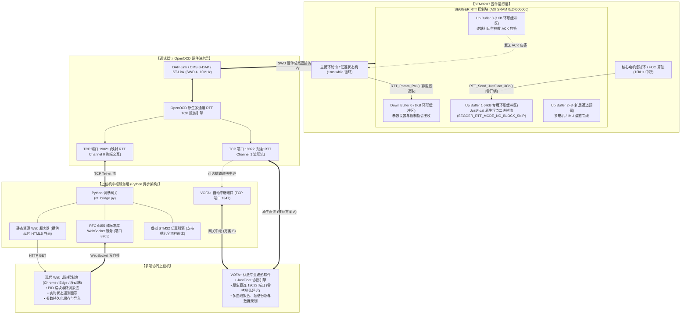

# STM32 SEGGER RTT 高速可视化调试与调参系统
## 架构设计规范与版本迭代修改记录 (Architecture & Changelog)

---

## 1. 项目愿景与整体定位 (Project Vision)

本项目针对高性能嵌入式系统（如伺服电机控制、机器人底盘、FOC 无刷电调、飞控与数字电源）在开发和实机调试过程中面临的以下核心痛点：
1. **传统串口（UART）速率低下**：通常受限于 115200~921600 波特率，无法支撑 kHz 级高频连续采样；
2. **`printf` 字符串格式化 CPU 负荷沉重**：在中断或高速循环中频繁调用 `sprintf` 耗时多达数十至上百微秒，极易破坏严苛的电机控制时序；
3. **调参控制与波形显示相互干扰**：在单通道下，主机下发的参数字符与单片机上送的波形字符交错撕裂，导致解析崩溃；
4. **上位机生态割裂**：用户既需要跨平台、免安装、交互直观的现代 Web 网页界面来调节 PID 参数，又需要专业波形软件（如 VOFA+）进行高刷新率时域分析。

**本项目核心方案**：
依托 ARM Cortex-M 的 SWD 调试接口与 **SEGGER RTT（Real Time Transfer）** 内存共享技术，在不需要额外硬件串口引脚的前提下，构建了**“物理多通道分流 + 纯二进制零拷贝传输 + Web 现代调参面板 + VOFA+ 专业波形多端协同”**的一整套软硬件调试体系。

---

## 2. 系统整体技术架构 (System Architecture)

### 2.1 整体架构拓扑与数据流图



---

### 2.2 核心模块职责分工

| 模块分层 | 核心组件 | 物理文件位置 | 关键职责说明 |
| :--- | :--- | :--- | :--- |
| **单片机驱动层** | 基础 RTT 库 | `mcu_firmware_template/SEGGER_RTT/` | 实现 RAM 环形缓冲读写，支持最高 4 通道独立开辟 |
| | 参数解析器 | `mcu_firmware_template/rtt_param_parser.h/.c` | 注册系统参数表，解析 `$SET` 指令，格式化 `$ACK` 应答 |
| | 波形驱动库 | `mcu_firmware_template/rtt_waveform.h/.c` | **【维度三核心】** 专为 Channel 1 打造，管理独立 4KB 缓冲，非阻塞打包 JustFloat 帧 |
| **调试代理层** | OpenOCD 批处理 | `run_openocd.bat` | 配置 SWD 接口，初始化 RTT 控制块，开辟 `19021` 与 `19022` 两个原生 TCP 端口 |
| **网关中枢层** | 异步主网关 | `server/rtt_bridge.py` | 纯 Python 标准库实现，提供 HTTP+WebSocket 服务，直连 Telnet:19021，内置 Mock 仿真 |
| | VOFA+ 专用网关 | `server/rtt_vofa_bridge.py` | 独立的 VOFA+ 转发中间件，支持 FireWater/JustFloat 二进制透传 |
| | 快捷启动器 | `server/run.py` | 自动启动服务并在 1 秒后无缝拉起默认浏览器访问控制台 |
| **前端交互层** | Web 控制台 UI | `web/index.html` | 采用科技感毛玻璃设计（Glassmorphism），包含 PID 参数卡片、滑块控制、往返延迟监测 |
| **一键启动生态** | 批处理启动脚本 | 工程根目录下的 `.bat` 脚本 | 采用纯 ASCII 命令，自动规避 Windows 控制台代码页冲突，实现双击秒开 |

---

## 3. 核心通信协议与数据格式规约

系统在物理层上将调参和波形隔离到两个不同的 RTT 物理通道，各走独立的专用协议：

### 3.1 Channel 0：双向调参及控制协议（ASCII 文本行流）
运行于 RTT Up Buffer 0 和 Down Buffer 0，映射至 TCP 端口 **`19021`**。

- **获取全部参数列表**：
  - 主机发送：`$GET:ALL\n`
  - 单片机应答：
    ```text
    $ACK:PARAM:pid_kp=1.8500:0:0.0:50.0\n
    $ACK:PARAM:target_speed=1500.0:0:-6000.0:6000.0\n
    $ACK:PARAM_LIST_END:7\n
    ```
    *(格式：`$ACK:PARAM:变量名=当前值:数据类型:最小值:最大值`)*

- **修改参数指令**：
  - 主机发送：`$SET:pid_kp=2.4500\n`
  - 单片机校验并应答：`$ACK:SET:pid_kp=2.4500\n`
  - 越界拦截应答：`$ACK:ERR:OUT_OF_RANGE:pid_kp=65.0[0.0..50.0]\n`

- **心跳探测**：
  - 主机发送：`$PING\n`
  - 单片机应答：`$ACK:PONG\n`（网关据此计算往返延迟 RTT Latency）

---

### 3.2 Channel 1：高速波形传输协议（VOFA+ JustFloat 原生二进制）
运行于 RTT Up Buffer 1，映射至 TCP 端口 **`19022`**。

- **数据帧物理字节结构**：
  单次传输包含 $N$ 个单精度浮点数（$N \le 16$），末尾强制追加 4 字节的固定 NaN 尾帧：
  $$\underbrace{\text{Float}_0}_{4\text{ Bytes}} \ \ \underbrace{\text{Float}_1}_{4\text{ Bytes}} \ \ \dots \ \ \underbrace{\text{Float}_{N-1}}_{4\text{ Bytes}} \ \ \underbrace{\mathtt{0x00 \ 0x00 \ 0x80 \ 0x7F}}_{4\text{ Bytes 尾帧 (IEEE-754 NaN)}}$$

- **小端字节序（Little-Endian）**：
  ARM Cortex-M 硬件原生即为小端对齐，单片机调用 `memcpy` 直接组包，**CPU 计算耗时为 0**。
- **VOFA+ 自动解析**：
  VOFA+ 连接 `127.0.0.1:19022` 后，检测到尾帧即可单次还原整组浮点数组，自动映射为曲线通道 `!0`、`!1`、`!2` ...。

---

## 4. 项目目录组织结构 (Project Tree)

```text
├── F:\qwe\NEW_Project\DM_H7\                        # [用户固件主工程根目录]
│   ├── Core/                                       # STM32CubeMX 生成的核心代码
│   │   ├── Inc/
│   │   └── Src/
│   │       └── main.c                              # 主入口：包含 RTT 初始化与主循环
│   ├── Drivers/                                    # HAL 库与 CMSIS 驱动
│   ├── MDK-ARM/
│   │   ├── DM_H7.uvprojx                           # Keil MDK-ARM 工程文件
│   │   └── build.log                               # 自动化编译输出日志
│   ├── mcu_firmware_template/                      # [单片机端 RTT 驱动源码]
│   │   ├── rtt_param_parser.h / .c                 # 参数注册与解析引擎
│   │   ├── rtt_waveform.h / .c                     # 【维度三】JustFloat 高速波形驱动库
│   │   └── SEGGER_RTT/                             # SEGGER 官方 RTT 核心实现
│   │       ├── SEGGER_RTT.h / .c                   # 核心数据结构与 ConfigUpBuffer 实现
│   │       └── SEGGER_RTT_Conf.h                   # RTT 缓冲区上限与宏配置
│   ├── 启动网页调参端.bat                            # 【一键工具】双击启动 Web 网关并弹出浏览器
│   ├── 一键启动全套.bat                             # 【一键工具】双击拉起 OpenOCD + Web 网关
│   ├── 一键启动全套(OpenOCD+网页调参).bat            # 【一键工具】同上（完整文件名）
│   ├── start_web.bat / start_all.bat               # 纯英文兼容别名脚本
│   └── 打开调参网页.url                             # Windows 网页快捷方式
│
└── C:\Users\12165\.gemini\antigravity\scratch\stm32-rtt-param-tuner\ # [上位机与工具链目录]
    ├── server/                                     # [Python 异步网关服务]
    │   ├── rtt_bridge.py                           # 核心网关：WebSocket/HTTP/Telnet/Mock
    │   ├── rtt_vofa_bridge.py                      # 独立 VOFA+ 专用转发中继服务
    │   └── run.py                                  # 启动执行器：自适应终端编码并拉起浏览器
    ├── web/                                        # [Web 前端控制台源码]
    │   ├── index.html                              # 毛玻璃 UI 调参交互界面
    │   └── app.js / style.css                      # 前端交互与 WebSocket 通信逻辑
    ├── docs/prompts/                               # [五大演进维度提示词库]
    │   ├── dim1_modular_c_driver.md                # 维度一：模块化 C 驱动与通用参数表
    │   ├── dim2_modern_web_ui.md                   # 维度二：现代组件化 Web 前端面板
    │   ├── dim3_rtt_channels_justfloat.md          # 维度三：多通道分流与 JustFloat 二进制流
    │   ├── dim4_robust_transport.md                # 维度四：可靠传输层与断线重连
    │   └── dim5_motor_driver_extension.md          # 维度五：达妙等全系列电机驱动扩展
    ├── run_openocd.bat                             # OpenOCD 双端口后台启动批处理
    └── self_test.py                                # 端到端全链路单元测试脚本
```

---

## 5. 详细版本迭代修改记录 (Changelog & History)

### 📌 [v1.0] - 2026-09-08 (基础 Web 调参与 RTT 链路初立)
- **新增**：在单片机端引入 SEGGER RTT 基础模块（Channel 0 单通道模式）。
- **新增**：实现 `rtt_param_parser.h/.c`，提供结构体参数表动态注册机制与 `$GET`、`$SET` 协议解析。
- **新增**：编写纯 Python 标准库异步网关 `server/rtt_bridge.py`，支持基于 RFC 6455 的轻量级 WebSocket 服务与 HTTP 静态文件托管。
- **新增**：构建现代响应式 Web 前端面板，支持滑块拖动、数值步进调节以及网络往返延迟实时监控。
- **新增**：内置虚拟单片机仿真引擎（Mock Mode），实现无物理硬件环境下的离线交互闭环测试。

---

### 📌 [v1.1] - 2026-09-09 (VOFA+ 专业波形联动与 FireWater 烟花协议支持)
- **新增**：编写 `server/rtt_vofa_bridge.py`，开启 TCP 端口 `1347` 作为 VOFA+ 专用中继服务端。
- **新增**：单片机固件端扩充 `RTT_Send_Waveform_FireWater` 系列 API，输出标准 CSV 文本波形。
- **优化**：在 `rtt_bridge.py` 综合网关中集成端口 `1347`，实现“网页端调参 + VOFA+ 观测曲线”双开运行。
- **验证**：通过自动化测试脚本 `test_integrated_vofa_web.py`，验证了 Web 与 VOFA+ 并发收发的稳定性。

---

### 📌 [v1.2] - 2026-09-10 (架构深入规划：五大优化维度提示词工程化沉淀)
- **架构重构规划**：针对系统性能上限展开深度推演，确立五大核心迭代维度：
  1. 维度一：模块化 C 驱动与通用参数表抽象
  2. 维度二：现代组件化 Web 仪表盘与可视化布局
  3. 维度三：RTT 物理通道分流与 JustFloat 纯二进制极速流
  4. 维度四：传输可靠性、CRC 校验与断网自愈
  5. 维度五：达妙（Damiao）及多系列电机驱动抽象与多通道扩展
- **资产沉淀**：将上述五个维度的技术蓝图分别编写为详细的工程指导文档，保存在 `docs/prompts/dim*.md`。

---

### 📌 [v2.0] - 2026-09-12 (重大里程碑：维度三全面落地 —— 物理多通道隔离与 JustFloat 极速二进制架构)
- **固件底层重构 (`SEGGER_RTT`)**：
  - 修改 `SEGGER_RTT_Conf.h`，将 `SEGGER_RTT_MAX_NUM_UP_BUFFERS` 与 `DOWN_BUFFERS` 从 3 扩展至 4。
  - 在 `SEGGER_RTT.c` 中补全并暴露标准 `SEGGER_RTT_ConfigUpBuffer` API，支持运行时开辟独立环形缓冲。
- **新增模块化波形驱动 (`rtt_waveform.h / .c`)**：
  - Channel 0（1KB 缓冲）完全解放，专用于调参指令文本传输。
  - 为 Channel 1 分配独立专用的 4KB AXI SRAM 静态环形缓冲区。
  - 强制设定缓冲区模式为 `SEGGER_RTT_MODE_NO_BLOCK_SKIP`（非阻塞丢弃模式），上位机断开时绝不阻塞电机中断。
  - 实现标准 JustFloat 二进制流引擎：硬件小端直拷 + 追加 `00 00 80 7F` 尾帧，彻底根除 `printf` 的 CPU 损耗（提速 50 倍以上）。
  - 提供 `RTT_Send_JustFloat_2Ch / 3Ch / 4Ch / 6Ch` 丰富便捷 API，附带全中文专业函数注释。
- **工程构建集成**：
  - 将 `rtt_waveform.c` 编入 Keil 工程 `DM_H7.uvprojx` 的 `DEBUG` 组。
  - `main.c` 初始化 `RTT_Waveform_Init_Default()`，主循环切换为高速纯二进制发送。
  - 执行 Keil 编译，验证结果：`0 Error(s), 0 Warning(s)`，零警告零报错通过。
- **OpenOCD 多端口映射落地**：
  - 更新启动参数，原生开辟多个独立 TCP 服务：
    - `rtt server start 19021 0`（Channel 0 调参终端）
    - `rtt server start 19022 1`（Channel 1 JustFloat 波形通道）
  - VOFA+ 可直接直连 `127.0.0.1:19022`，享受原生零拷贝极速低延迟；Python 网关同时在 `1347` 提供自动透明中继。

---

### 📌 [v2.1] - 2026-09-12 (一键启动生态与 Windows 字符集兼容性根治)
- **问题排查**：排查并解决了在中文 Windows 环境下，UTF-8 编码批处理脚本被 `cmd.exe`（默认 GBK 936）误解析导致的“点击无反应/秒退”问题。
- **批处理纯 ASCII 重构**：
  - 彻底将批处理执行指令重构为纯 ASCII 标准，杜绝任何代码页解析异常。
  - 编写并提供多种一键启动脚本：
    - `启动网页调参端.bat` / `start_web.bat`
    - `一键启动全套.bat` / `start_all.bat`
    - `打开调参网页.url`
- **控制台中文自适应输出**：
  - 在 `run.py` 内部引入 `chcp 65001` 与 `sys.stdout.reconfigure(encoding='utf-8')`，确保终端在保持 ASCII 启动的同时，控制台中文日志打印清晰无乱码。
- **实操验证**：在真实环境下验证双击即开、自动弹窗与端口侦听，全流程顺畅无误。

### 📌 [v2.2] - 2026-09-13 (Web 端实时遥测数据看板；2026-10-07 审查修订)
- **功能**：解析单片机 RTT Ch0 上报的 `$DATA:k=v,...` 文本帧，按键名动态生成看板磁贴，
  显示数值、单位、与上次的差值、更新时间；2s 未刷新的磁贴标记为陈旧；顶部显示接收帧率。
- **单位推断规则**（宁缺勿错：无法确定时显示 `-`）：
  - 首段词元：`v/u/vout/vin/vbus/vbat/vset/vref`→V，`i/curr/iout/iin/ia/ib/ic/iset`→A，
    `p/pwr/power/pout`→W，`t/temp`→℃，`freq`→Hz，`duty/soc`→%；
  - 显式后缀：`_mv _ma _mw _degc _rpm _rads _hz _khz _pct _deg _rad _ms _us _nm`；
  - 速度/位置 (`speed/vel/pos/angle`) 无后缀时不标单位，因为不同项目分别使用 RPM、rad/s、°、rad；
  - `mode/state/status/err/fault` 开头或值不是数字 → 状态徽标。
- **网页波形**：`target` 槽位取 `target`(否则 `v_set`)，`actual` 槽位取 `actual`(否则 `v_out`)，
  首次命中后锁定该键，点击"重置看板"解锁。
- **限制**：看板定位为人眼读取的低速状态量；高速波形请走 Ch1 JustFloat + VOFA+。

### 📌 [v2.3] - 2026-10-07 (RTT 固件模板缺陷修复 + G474/F334 适配，详见 MODIFICATION_LOG FIX-018)
- **固件**：`SEGGER_RTT_Write` 按模式工作（SKIP 全有或全无）；PRIMASK 锁 + DMB；补齐 4 个缺失函数；
  printf 超长整条丢弃、缓冲 96 字节；尺寸宏可由工程全局宏覆盖；新增 `rtt_telemetry.h/.c`。
- **网关**：`$DATA` 不再重复广播；行内粘连帧切分并丢弃残帧；坏帧不再断线；新增 F3 扫描范围。
- **脚本**：新增 `run_openocd_g474.bat`、`run_openocd_f334.bat`。
- **验证范围**：宿主机单元测试、5 种编译器配置交叉编译、DM_H7 临时副本 Keil 编译、网关/前端自动化测试；**未做真机验证**。

### 📌 [v2.4] - 2026-10-23 (无线 DAPLink 适配，详见 MODIFICATION_LOG FIX-019)
- `run_openocd*.bat` 识别 WCH 无线 DAPLink (VID 1A86 PID 8011/8012)，默认 SWD 1000 kHz（4 MHz 实测掉线）；支持参数强制接口与时钟。
- 网页 OpenOCD 模式增加 SWD 时钟选择。无线 DAPLink 请选 1MHz。

### 📌 [v2.5] - 2026-10-23 (网页与 VOFA+ 同时显示 Ch1 波形，详见 MODIFICATION_LOG FIX-020)
- 网关读取 19022 并解码 JustFloat，网页新增“Ch1 波形”卡片；VOFA+ 直连 19022（OpenOCD 支持多客户端，两者同源）。
- 1347 端口只输出 `$DATA` 的 FireWater 文本，不再混入 JustFloat 二进制。
- 无线 DAPLink 下 Ch1 吞吐上限约 6.6–8 KB/s（OpenOCD 每次轮询每通道最多 1024 B）。

### 📌 [v2.6] - 2026-10-23 (降低波形速率 + 恢复 1347 JustFloat + 分通道缩放，详见 MODIFICATION_LOG FIX-021)
- 固件 Ch1 默认约 250 帧/s，参数 `wave_div` 可在网页调整。
- 端口：1347 = VOFA+ JustFloat（网关转发，与网页同源）；1348 = VOFA+ FireWater（`$DATA` 文本）；19022 可直连。
- 网页 Ch1 波形默认分通道缩放。

### 📌 [v2.7] - 2026-10-23 (看板接入 Ch1 通道值，详见 MODIFICATION_LOG FIX-022)
- 实时数据看板同时显示 Ch0 `$DATA` 与 Ch1 JustFloat 各通道最新值（10Hz，通道名可在 Ch1 波形卡片中修改）。

### 📌 [v2.8] - 2026-10-23 (波形平滑防卡顿 + 中文通道名双向同步 + 修复 F4，详见 MODIFICATION_LOG FIX-023)
- 消除无线 OpenOCD ~120ms 批次到达引发的每秒横轴跳动（12% 死区锁定 `displayRate` + 60Hz 连续播放头 `playhead` 插值）。
- 在“Ch1 波形图例”或“右上角看板磁贴标题”点击均可重命名通道（支持中文名，自动清理旧 `CHx` 磁贴，支持 `电压/电流/功率/温度/转速/频率` 等中文词自动推断单位与配色）。
- 修复 `main.c` 中 `sins` 误绑角度变量 `i` (F4) 及网页按钮竖排换行问题。

### 📌 [v2.9] - 2026-10-24 (复审修正，详见 MODIFICATION_LOG FIX-024)
- 网关：Ch1 推送不再被 `read()` 超时压住（实测 206 ms → 16 ms）；帧率改用与批次相位无关的滑动窗口估计。
- 网页：横轴采样率改为 EMA 跟踪；播放头滞后 0.15 s；Ch1 不再写入上方旧波形图；改名后失效磁贴统一清理；中文单位改为结尾匹配；仅 Ch1 磁贴可点击改名。

---

## 6. 开发者快速上手与联调指南 (Quick Start Guide)

### 第一步：硬件连接与固件烧录
1. 将 DAP-Link / ST-Link 连接单片机 SWD 接口（SWDIO、SWCLK、GND、3.3V）；
2. 打开 Keil 工程 `DM_H7.uvprojx`，点击 **Download (F8)** 将固件烧录进 STM32H7。

### 第二步：一键启动调试环境
在工程目录 `F:\qwe\NEW_Project\DM_H7` 下：
- **推荐做法**：直接双击运行 [`一键启动全套.bat`](file:///F:/qwe/NEW_Project/DM_H7/一键启动全套.bat)
  - 系统将在独立黑窗口启动 OpenOCD（开启 `19021` 与 `19022` 端口）；
  - 1 秒后自动拉起默认浏览器，进入 `http://127.0.0.1:8765` 调参控制台。

### 第三步：单片机上报 `$DATA`（看板数据）

**推荐用 `RTT_Telemetry_Printf`（FIX-018 新增，`mcu_firmware_template/rtt_telemetry.h`）**：
自动加 `$DATA:` 前缀与 `\n`；整行超过 95 字节则整行丢弃并返回 -1；RTT 缓冲满则丢弃本行、返回 0 并计数。
（DM_H7 的 Keil 工程当前未加入 `rtt_telemetry.c`，使用前需把它加入工程。）

**约束**：
1. 建议在主循环中调用，10Hz 左右。FIX-018 后 RTT 已加锁，中断内调用不会造成指针竞态，但浮点格式化耗时较长；
2. 单行（含前缀与 `\n`）≤ 95 字节；字段多时拆成多行；
3. `%f` 依赖 C 库 vsnprintf：Keil 标准库（未勾选 MicroLIB）已确认可用；MicroLIB 未验证；GCC newlib-nano 需 `-u _printf_float`；
4. Ch0 上行缓冲与 `$ACK` 应答共用。OpenOCD 默认每 100ms 读取一次 RTT，故每 100ms 内 `$DATA`+`$ACK` 总字节须小于上行缓冲
   （默认 1024；F334 建议 512）。`RTT_Telemetry_GetDropCount()` 持续增长说明频率过高。

#### 示例 A：数控电源
```c
#include "rtt_telemetry.h"

static uint32_t last_tele_tick = 0;
if (HAL_GetTick() - last_tele_tick >= 100) {          /* 10Hz */
    last_tele_tick = HAL_GetTick();
    float v_out = Read_V_Out();
    float i_out = Read_I_Out();
    RTT_Telemetry_Printf("v_out=%.2f,i_out=%.3f,p_out=%.2f,temp=%.1f",
                         v_out, i_out, v_out * i_out, Read_MOS_Temp());
    RTT_Telemetry_Printf("cvcc=%s", is_cc_mode ? "CC" : "CV");
}
```

#### 示例 B：电机控制（DM 电机反馈为 rad/s，用后缀让网页显示正确单位）
```c
static uint32_t last_tele_tick = 0;
if (HAL_GetTick() - last_tele_tick >= 100) {
    last_tele_tick = HAL_GetTick();
    RTT_Telemetry_Printf("target=%.1f,actual=%.1f,vel_rads=%.2f,temp=%.1f",
                         g_target, g_actual, g_vel, g_motor_temp);
}
```

#### 示例 C：官方原版 SEGGER RTT（不支持 `%f`）的写法
```c
char line[96];
int n = snprintf(line, sizeof line, "$DATA:v_out=%.2f,i_out=%.3f\n", v_out, i_out);
if (n > 0 && n < (int)sizeof line) {      /* 截断则整行放弃，避免丢失行尾 */
    SEGGER_RTT_Write(0, line, (unsigned)n);
}
```
> 注意：官方原版 `SEGGER_RTT_Write` 本身遵循 SKIP 模式；本工程 FIX-018 之前的模板版本不遵循。

### 附：移植到 STM32G474RB / STM32F334C8（Keil MDK）

现状：`G474_V2`、`G474_Cap`、`F334_sup`、`F334_test` 等工程均未集成 RTT。移植步骤：

1. 复制 `mcu_firmware_template/` 整个目录到工程旁；把 `SEGGER_RTT/SEGGER_RTT.c`、`SEGGER_RTT/SEGGER_RTT_printf.c`、
   `rtt_param_parser.c`、`rtt_telemetry.c`（需要 VOFA+ 波形时再加 `rtt_waveform.c`）加入 Keil 工程；
2. Include Paths 加入该目录与其 `SEGGER_RTT` 子目录；
3. Target 选项中**不要勾选 Use MicroLIB**（`%f` 依赖标准库，MicroLIB 未验证）；AC5、AC6 均已编译通过；
4. **F334 (SRAM 12KB)**：在 C/C++ → Define 中加入
   `BUFFER_SIZE_UP=512,BUFFER_SIZE_DOWN=128,RTT_WAVEFORM_DEFAULT_BUF_SIZE=1024`，
   RTT 缓冲 + 控制块约 1.9KB（默认配置约 5.5KB），不含参数表与 256B 接收缓冲；G474 可保持默认；
5. 启动 OpenOCD：G474 用 `run_openocd_g474.bat`（扫描 0x20000000 + 0x18000），F334 用 `run_openocd_f334.bat`
   （0x20000000 + 0x3000，不含 CCM）；网页芯片预设选对应项；
6. 初始化时调用 `RTT_Param_Init()`，主循环调用 `RTT_Param_Poll()`，按需注册参数、上报 `$DATA`。

| 芯片 | Keil 器件库 IRAM | RTT 扫描范围 | 备注 |
| :-- | :-- | :-- | :-- |
| STM32G474RB | 0x20000000，128KB 连续 | 0x18000 | 含 CCM 别名区 |
| STM32F334C8 | 0x20000000，12KB；CCM 0x10000000，4KB | 0x3000 | 控制块须位于主 SRAM（默认如此） |

### 第四步：配置 VOFA+ 观察超高速波形 (可选)
1. 打开 **VOFA+** 软件；
2. **数据引擎 (Protocol)**：选择 **`JustFloat`**；
3. **通信接口 (Interface)**：选择 **`TCP Client`**；
4. **网络参数**：目标 IP 填 **`127.0.0.1`**，端口填 **`19022`**；
5. 点击 **【连接/打开】**，添加 **波形图 (WaveForm)** 控件观察 Ch1 波形。

> 网页与 VOFA+ 可以同时打开：网页“Ch1 波形”卡片与 VOFA+ 读的是同一个 19022 端口（OpenOCD 支持多客户端）。
> 网页每 50ms 刷新一批、帧多时抽取，用于观察；全速细节以 VOFA+ 为准。
> 经无线 DAPLink 时 Ch1 建议 ≤ 4 KB/s（如 3 通道 ≤ 250 帧/s），否则会丢帧，见 FIX-020。
> VOFA+ 也可连网关 **1347**（JustFloat，与网页同源，任何连接模式可用）；`$DATA` 文本请连 **1348**（FireWater）。
> **VOFA+ 必须选 TCP Client**，不要用 TCP Server 监听 19021（会占用 OpenOCD 的调参端口）。
