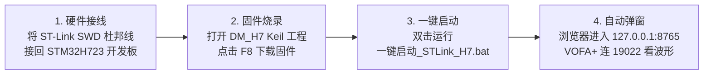

# STM32 RTT 通信故障诊断排查与全场景解决方案指南
## (ST-Link / 正点原子 F103 / STM32H7 双路径落地操作手册)

---

## 1. 故障现场与实机诊断报告

针对使用正点原子 ST-Link 烧录器连接时出现的**“无法通信”**现象，底层工具已对单片机内存与寄存器进行实机探测，核心诊断结果如下：

### 1.1 硬件探测原始数据
```text
[调试器识别] : STLINK V2J35S7 (API v2) VID:PID 0483:3748
[目标板供电] : Target voltage = 3.165 V (供电正常)
[CPU 核心识别]: SWD DPIDR 0x1ba01477 (Cortex-M3 r1p1 核心)
[芯片型号代码]: DBGMCU_IDCODE (0xE0042000) = 0x10036414
                -> DEV_ID = 0x414 (对应 STM32F103 高容量系列，如战舰版 F103ZET6 / 精英版 F103RCT6)
```

### 1.2 导致无法通信的四大核心原因

| 故障根因 | 现象描述 | 技术根源分析 |
| :--- | :--- | :--- |
| **原因 1：内存中无 RTT 控制块（根本原因）** | OpenOCD 报错：<br>`rtt: No control block found` | RTT 通信机制要求单片机程序必须运行包含 `_SEGGER_RTT` 结构体的代码。实测 dump 导出当前 F103 的 64KB RAM 发现**未检索到 `"SEGGER RTT"` 字符串**（说明当前运行的是普通出厂例程/点灯代码，未运行 RTT 固件）。 |
| **原因 2：RAM 扫描范围越界引发硬件故障** | OpenOCD 报错：<br>`Failed to read memory at 0x20010004` | 原配置默认按 H7 分配了 `0x40000` (256KB) 搜索范围。而 F103 物理 SRAM 仅有 **64KB**（`0x20000000 ~ 0x20010000`），读到 `0x20010004` 时总线返回 Bus Fault 异常退出。必须设定为 `0x10000` (64KB)。 |
| **原因 3：批处理脚本写死调试器接口** | 脚本直接闪退或报错：<br>`unable to find a matching CMSIS-DAP` | 原部分启动脚本配置的是 `interface/cmsis-dap.cfg`，插正点原子 ST-Link 烧录器时无法识别。必须使用 `interface/stlink.cfg`。 |
| **原因 4：OpenOCD 参数引号转义冲突** | 报错：<br>`Unexpected command line argument: start -c rtt` | Windows 下向 Python 传递 `\"SEGGER RTT\"` 时引号被转义截断。已在底层统一修复为 OpenOCD/TCL 原生语法 `{SEGGER RTT}`。 |

---

## 2. 解决方案 A：切回目标芯片 STM32H723（官方推荐主线）

如果您的最终目标是运行电机控制的 **STM32H723** 板子，只需换回 H7 板即可享受已编译验证好的全部成果。



### 操作步骤：
1. **硬件接线**：将 ST-Link 的 `SWCLK`、`SWDIO`、`GND`、`3.3V` 4 根线接至 **STM32H723** 开发板对应的 SWD 接口。
2. **烧录已编译好的固件**：
   - 打开 Keil MDK 工程：`F:\qwe\NEW_Project\DM_H7\MDK-ARM\DM_H7.uvprojx`
   - 工程中已经集成了全部中文注释的 `rtt_waveform.c` 和 `rtt_param_parser.c`；
   - 点击 Keil 顶部的 **Download (F8)** 按钮，将固件烧录进 H7。
3. **一键启动**：
   - 双击运行：[`一键启动_STLink_H7.bat`](file:///F:/qwe/NEW_Project/DM_H7/一键启动_STLink_H7.bat)
   - 系统将自动调用 `interface/stlink.cfg` + `target/stm32h7x.cfg`，以 `0x24000000` 基地址建立 Channel 0（19021）和 Channel 1（19022）服务，并自动弹出浏览器！

---

## 3. 解决方案 B：就在正点原子 STM32F103 上快速跑通验证

如果您希望**先就地使用手头的正点原子 F103 开发板**体验 Web 调参和 VOFA+ JustFloat 实时波形，按以下步骤仅需 3 分钟即可打通：

### 步骤 3.1：向您的 F103 工程添加 RTT 驱动文件
找一个现成能跑的正点原子 F103 基础工程（如跑马灯/按键例程），把本工具链模板目录中的以下 3 组文件拷贝/加入到 Keil 工程中：
- `mcu_firmware_template/SEGGER_RTT/`（全部源码）
- `mcu_firmware_template/rtt_param_parser.h` 与 `.c`
- `mcu_firmware_template/rtt_waveform.h` 与 `.c`

### 步骤 3.2：在 F103 的 `main.c` 中添加极简测试代码

```c
#include "SEGGER_RTT.h"
#include "rtt_param_parser.h"
#include "rtt_waveform.h"
#include <math.h>

// 定义测试变量
float test_val = 1.85f;
float test_sin = 0.0f;
float test_cos = 0.0f;
float phase = 0.0f;

int main(void) {
    // 1. 基础硬件初始化 (延时、时钟、LED等)
    HAL_Init();
    SystemClock_Config();
    
    // 2. 初始化 RTT 波形 Channel 1 缓冲区
    SEGGER_RTT_Init();
    RTT_Waveform_Init_Default();
    
    // 3. 注册一个测试参数供网页调节
    RTT_Param_Register_Float("test_val", &test_val, 0.0f, 10.0f);

    while (1) {
        // 轮询网页下发的 $SET/$GET 调参指令
        RTT_Param_Poll();

        // 计算模拟波形
        phase += 0.05f;
        test_sin = sinf(phase) * 100.0f;
        test_cos = cosf(phase) * 80.0f;

        // 向 Channel 1 高速发送 3 路 JustFloat 二进制波形给 VOFA+
        RTT_Send_JustFloat_3Ch(test_sin, test_cos, test_val);

        HAL_Delay(5); // 200Hz 刷新率
    }
}
```

### 步骤 3.3：编译并烧录至 F103
在 Keil 中使用 ST-Link 将程序烧录进这块正点原子 F103 板子。

### 步骤 3.4：一键启动 F103 专用调试服务
直接双击运行为您预置的脚本：
[`一键启动_STLink_F103.bat`](file:///F:/qwe/NEW_Project/DM_H7/一键启动_STLink_F103.bat)

> **该脚本执行的命令规范如下（完全适配 F103 特性）**：
> ```cmd
> openocd -f interface/stlink.cfg -f target/stm32f1x.cfg -c "adapter speed 4000" -c "init" -c "rtt setup 0x20000000 0x10000 {SEGGER RTT}" -c "rtt start" -c "rtt server start 19021 0" -c "rtt server start 19022 1"
> ```
> - 接口：`interface/stlink.cfg`（正点原子官方烧录器原生适配）
> - 芯片：`target/stm32f1x.cfg`（Cortex-M3 目标识别）
> - 内存：起始基址 `0x20000000`，扫描范围限制为 `0x10000` (64KB)，彻底规避内存越界 Bus Fault。

---

## 4. 核心芯片参数配置对照速查表

便于在 Web 控制台顶部下拉框选择不同芯片时参考：

| 芯片型号 | 芯片系列 | OpenOCD 配置文件 | RAM 起始基地址 | 建议扫描大小 | 典型应用板卡 |
| :--- | :--- | :--- | :--- | :--- | :--- |
| **STM32H723VG** | Cortex-M7 | `target/stm32h7x.cfg` | **`0x24000000`** (AXI SRAM) | `0x40000` (256KB) | 本工程主开发板 / 达妙电机主板 |
| **STM32F103ZE/RC**| Cortex-M3 | `target/stm32f1x.cfg` | **`0x20000000`** (SRAM) | **`0x10000`** (64KB) | 正点原子战舰版 / 精英版开发板 |
| **STM32F407ZG** | Cortex-M4 | `target/stm32f4x.cfg` | `0x20000000` (SRAM) | `0x20000` (128KB) | 正点原子探索者 / 各种常用飞控板 |
| **STM32G474RE** | Cortex-M4 | `target/stm32g4x.cfg` | `0x20000000` (SRAM) | `0x18000` (96KB) | 数字电源 / 高性能数字 FOC 驱动器 |

---

## 5. 现已就绪的启动工具一览

位于工程主目录 [`F:\qwe\NEW_Project\DM_H7`](file:///F:/qwe/NEW_Project/DM_H7)：

| 文件名称 | 针对硬件配置 | 作用说明 |
| :--- | :--- | :--- |
| [`一键启动_STLink_H7.bat`](file:///F:/qwe/NEW_Project/DM_H7/一键启动_STLink_H7.bat) | ST-Link + STM32H723 | 针对当前主工程板子的一键启动全套服务 |
| [`一键启动_STLink_F103.bat`](file:///F:/qwe/NEW_Project/DM_H7/一键启动_STLink_F103.bat) | ST-Link + 正点原子 F103 | 针对手头这块正点原子 F103 的一键启动全套服务 |
| [`一键启动全套.bat`](file:///F:/qwe/NEW_Project/DM_H7/一键启动全套.bat) | 自适应通用启动 | 默认启动器，集成环境检查与浏览器自动呼出 |
| [`启动网页调参端.bat`](file:///F:/qwe/NEW_Project/DM_H7/启动网页调参端.bat) | 独立 Web 端 | 仅启动 Web 调参服务并弹窗（适合手动运行 OpenOCD 时使用） |
